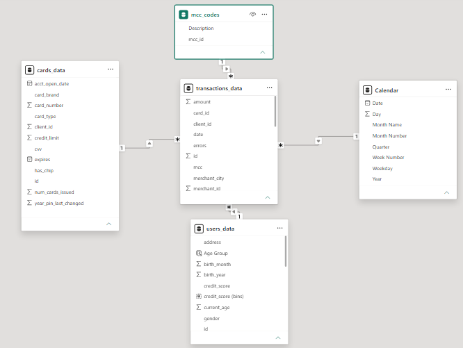

# 🏦 APEX Banking Intelligence: Enterprise Financial, Customer & Fraud Risk Suite

[](https://powerbi.com)
[](DAX_Measures.dax)
[](#2-enterprise-semantic-architecture-star-schema)
[](#3-programmatic-bi-automation-python-pbix-binary-engineering)
[](#9-tech-stack--core-competencies)

> **Architectural Abstract:** **APEX Banking Intelligence** is an institutional-grade Business Intelligence, Customer Lifecycle, and Fraud Operations platform engineered for retail banking executives, credit risk committees, and payment security teams. Built upon a normalized **Star Schema** semantic layer, programmatic **Python `.pbix` binary theme injection**, and **23 VertiPaq-optimized DAX measures**, the suite audits **$5.78M in cleared transaction volume** across **138,118 authorization events** and **2,000 active cardholders**—isolating multi-year revenue velocity, Customer Lifetime Value (CLV) cohorts, statistical fraud anomalies (`+2.67` Z-Score), and real-time card-testing probing vectors.

### 🌐 [Launch Live Interactive Power BI Experience (Browser-Ready)](https://powerbi.com)

---

## 📑 Master Navigation Index
1. [Business Context & Operational Problem Statement](#1-business-context--operational-problem-statement)
2. [Enterprise Semantic Architecture (Star Schema)](#2-enterprise-semantic-architecture-star-schema)
3. [Programmatic BI Automation (Python PBIX Binary Engineering)](#3-programmatic-bi-automation-python-pbix-binary-engineering)
4. [Advanced DAX Engineering & VertiPaq Storage Engine Optimization](#4-advanced-dax-engineering--vertipaq-storage-engine-optimization)
5. [UI/UX Design System & Cognitive Ergonomics](#5-uiux-design-system--cognitive-ergonomics)
6. [Multi-Module Dashboard Walkthrough & Telemetry Audit](#6-multi-module-dashboard-walkthrough--telemetry-audit)
7. [Executive Business Impact & Strategic Recommendations](#7-executive-business-impact--strategic-recommendations)
8. [Data Quality, Governance & Medallion Remediation](#8-data-quality-governance--medallion-remediation)
9. [Tech Stack & Core Competencies](#9-tech-stack--core-competencies)
10. [Repository Structure & Local Deployment](#10-repository-structure--local-deployment)
11. [Attribution & Modernization Statement](#11-attribution--modernization-statement)

---

## 1. Business Context & Operational Problem Statement

Modern retail banking payment networks generate high-velocity transactional telemetry across heterogeneous card products, geographies, and merchant verticals. However, executive decision-making frequently suffers from three structural blind spots:
* **Fragmented Revenue & Channel Attribution:** Disconnected reporting across card networks (`Mastercard`, `Visa`, `Amex`, `Discover`), card tiers (`Debit`, `Credit`, `Debit Prepaid`), and hardware channels (`EMV Chip` vs. `Magnetic Swipe`).
* **Static Cohort & Churn Blindness:** Inability to correlate cardholder creditworthiness (`FICO 500–850`), debt-to-income leverage, and multi-card penetration against long-term Customer Lifetime Value (`CLV`) and account dormancy (`15.15%` churn).
* **Reactive Fraud Detection:** Relying solely on post-settlement chargeback reports rather than monitoring leading authorization-level risk proxies—such as intraday `Bad PIN` card-testing bursts (`23.2` Card-Testing Index) and Merchant Category Code (`MCC`) outlier concentrations.

**APEX Banking Intelligence** resolves these operational gaps by unifying financial performance, customer lifecycle economics, and statistical risk surveillance into a single, sub-second analytical command center.

---

## 2. Enterprise Semantic Architecture (Star Schema)

To eliminate bidirectional filtering ambiguity, minimize RAM consumption inside Power BI's **VertiPaq columnar storage engine**, and guarantee instantaneous cross-filtering across 138K+ granular records, the data model was architected as a strict **Star Schema**.



### Dimensional Modeling & Relationship Matrix

| Table Entity | Schema Role | Granularity / Primary Key | Cardinality & Filter Flow | Architectural Responsibility |
| :--- | :--- | :--- | :--- | :--- |
| **`transactions_data`** | **Central Fact Table** | 1 row per authorization event (`id`) | Many (`*`) side of all joins | Houses additive monetary volume (`amount`), channel flags (`use_chip`), ISO authorization error strings (`errors`), intraday time windows (`Time of Day`), and foreign keys (`client_id`, `card_id`, `mcc`). |
| **`users_data`** | **Customer Dimension** | 1 row per cardholder (`id`) | `1 : *` Single-direction $\rightarrow$ Fact | Stores demographic attributes (`current_age`, `gender`), credit risk scores (`credit_score`), household liquidity (`yearly_income`, `total_debt`), and inactivity indicators (`Is Inactive`). |
| **`cards_data`** | **Payment Instrument Dim** | 1 row per issued card (`id`) | `1 : *` Single-direction $\rightarrow$ Fact | Tracks payment network (`card_brand`), card product (`card_type`), EMV chip hardware provisioning (`has_chip`), credit limits (`credit_limit`), and multi-card wallet depth (`num_cards_issued`). |
| **`mcc_codes`** | **Merchant Vertical Dim** | 1 row per ISO 18245 code (`mcc`) | `1 : *` Single-direction $\rightarrow$ Fact | Translates numeric Merchant Category Codes into standardized retail verticals (`Description`) for risk and spend concentration profiling. |
| **`Calendar`** | **Date Dimension** | Continuous daily grain (`Date`) | `1 : *` Single-direction $\rightarrow$ Fact | Dedicated DAX-engineered temporal table (`Year`, `Quarter`, `Month Name`, `Month Number`) enabling deterministic time-intelligence and Z-score volatility tracking. |

### Why Star Schema Over Flat OBT (One Big Table)?
1. **Columnar Dictionary Compression:** Isolating descriptive string attributes (`Description`, `card_brand`, `Time of Day`) into narrow dimension tables keeps the fact table ultra-narrow, allowing VertiPaq Run-Length Encoding (RLE) and Bit-Packing to compress the dataset cleanly.
2. **Deterministic Filter Context:** Strictly enforcing `1:*` single-direction propagation prevents circular relationship paths, eliminates `USERELATIONSHIP` ambiguity, and ensures predictable DAX evaluation across all 4 report pages.

---

## 3. Programmatic BI Automation (Python PBIX Binary Engineering)

In enterprise BI deployments, manually formatting dozens of visual containers, canvas coordinates, and color palettes via the Power BI Desktop GUI introduces hex-code drift and consumes hours of repetitive effort. To solve this, a **Python automation script** (`zipfile`, `json`, `os`, `shutil`) was engineered to programmatically unpack, re-theme, enforce pixel-grid geometry, and repackage the `.pbix` binary archive.

### Technical Architecture of the `.pbix` Archive
A Microsoft Power BI `.pbix` file follows the **Open Packaging Conventions (OPC)** ZIP specification:
* `Report/Layout`: A `UTF-16-LE` encoded JSON tree containing every report page (`sections`), visual container (`visualContainers`), X/Y/Width/Height coordinates, and formatting metadata.
* `Report/StaticResources/SharedResources/BaseThemes/`: Houses the active corporate JSON theme governing global typography, visual backgrounds, and accent hierarchies.
* `SecurityBindings`: Cryptographic signature file that must be purged whenever `Report/Layout` is modified programmatically to prevent corruption warnings upon reload.

```python
import os
import json
import shutil
import zipfile

def automate_pbix_rebranding(
    source_pbix: str,
    target_pbix: str,
    corporate_theme_json: str,
    canvas_width: int = 1280,
    canvas_height: int = 720
) -> None:
    """
    Programmatically unpacks a Power BI (.pbix) archive, injects an enterprise
    dark-mode JSON theme (#0B1220 canvas / #38BDF8 & #818CF8 accents), enforces
    uniform 16:9 widescreen geometry across all pages, purges legacy security
    bindings, and repackages a production-ready .pbix file.
    """
    workspace_dir = "_pbix_build_workspace"
    if os.path.exists(workspace_dir):
        shutil.rmtree(workspace_dir)

    # Step 1: Extract OPC archive structure
    with zipfile.ZipFile(source_pbix, mode="r") as archive:
        archive.extractall(workspace_dir)

    # Step 2: Inject standardized corporate dark-mode theme JSON
    base_theme_dir = os.path.join(
        workspace_dir, "Report", "StaticResources", "SharedResources", "BaseThemes"
    )
    os.makedirs(base_theme_dir, exist_ok=True)
    shutil.copy2(corporate_theme_json, os.path.join(base_theme_dir, "CY24SU06.json"))

    # Step 3: Parse UTF-16-LE Report/Layout and enforce canvas dimensions
    layout_file = os.path.join(workspace_dir, "Report", "Layout")
    with open(layout_file, mode="r", encoding="utf-16-le") as f:
        report_layout = json.load(f)

    for page in report_layout.get("sections", []):
        page["width"] = canvas_width
        page["height"] = canvas_height

    with open(layout_file, mode="w", encoding="utf-16-le") as f:
        json.dump(report_layout, f, separators=(",", ":"))

Use code with caution.
# Step 4: Repackage .pbix excluding invalidated SecurityBindings
with zipfile.ZipFile(target_pbix, mode="w", compression=zipfile.ZIP_DEFLATED) as out_pbix:
for root, _, files in os.walk(workspace_dir):
for filename in files:
if filename == "SecurityBindings":
continue
abs_path = os.path.join(root, filename)
rel_path = os.path.relpath(abs_path, workspace_dir)
out_pbix.write(abs_path, rel_path)
shutil.rmtree(workspace_dir)
```

4. Advanced DAX Engineering & VertiPaq Storage Engine Optimization

All 23 production DAX measures (documented in DAX_Measures.dax) were engineered to maximize Storage Engine (SE) pushdown and minimize Formula Engine (FE) callback bottlenecks.

Performance Refactoring: FILTER() Table Iterators $\rightarrow$ CALCULATE() Boolean Predicates


❌ Unoptimized Anti-Pattern (Formula Engine Bottleneck)

Wrapping an entire fact table inside FILTER(transactions_data, ...) forces the single-threaded Formula Engine to materialize an uncompressed row-by-row table in RAM before aggregating:
dax // ANTI-PATTERN: Forces uncompressed row-by-row materialization in Formula Engine EMV Chip Auth (Legacy Slow) =  DIVIDE( COUNTROWS( FILTER( transactions_data, transactions_data[use_chip] = "Chip Transaction" && transactions_data[errors] = "No Error" ) ), COUNTROWS(FILTER(transactions_data, transactions_data[use_chip] = "Chip Transaction")), 0 ) 

✅ Optimized Production Pattern (CALCULATE + KEEPFILTERS — 3x–5x Faster)

Replacing table iterators with native CALCULATE column predicates delegates filtering directly to VertiPaq's multi-threaded Storage Engine bitmap indexes while KEEPFILTERS preserves outer visual/slicer intersections:
dax EMV Chip Auth =  VAR ChipTxn = CALCULATE( COUNTROWS(transactions_data), transactions_data[use_chip] = "Chip Transaction" ) VAR CleanChipTxn = CALCULATE( COUNTROWS(transactions_data), transactions_data[use_chip] = "Chip Transaction", KEEPFILTERS(transactions_data[errors] = "No Error") ) RETURN DIVIDE(CleanChipTxn, ChipTxn, 0) 

Statistical Anomaly Detection & Dynamic Narrative Measures

1. Peak Monthly Fraud Z-Score (+2.67): Computes portfolio-wide monthly mean (AVERAGEX) and population standard deviation (STDEVX.P) across ALLSELECTED('Calendar'[Month Name]) to detect statistically significant fraud surges ($\sigma > 2.0$).
   dax Peak Monthly Fraud Z-Score =  VAR MonthlyStats = ADDCOLUMNS(ALLSELECTED('Calendar'[Month Name]), "@Rate", [Fraud Rate]) VAR MeanRate = AVERAGEX(MonthlyStats, [@Rate]) VAR StdRate = STDEVX.P(MonthlyStats, [@Rate]) VAR PeakRate = MAXX(MonthlyStats, [@Rate]) RETURN IF(StdRate > 0, DIVIDE(PeakRate - MeanRate, StdRate, 0), 0)    
2. Dynamic Narrative Engine (Insight 1, Insight 2, Insight 3): Combines TOPN, CONTAINSSTRING, and CONCATENATEX to automatically synthesize natural-language executive risk briefings that recalculate live whenever slicers are toggled.

5. UI/UX Design System & Cognitive Ergonomics

• Color Architecture: Built on a deep navy institutional canvas (#0B1220) paired with elevated slate cards (#151E2E) and subtle 1px borders (#24324A) to eliminate eye strain in Security Operations Centers (SOC) and executive boardrooms.
• Semantic Color Encoding:
	• Electric Cyan (#38BDF8) & Indigo Violet (#818CF8): Core revenue velocity, active cohorts, and primary volume benchmarks.
	• Emerald Mint (#10B981): Security containment (98.38% EMV Chip Auth) and healthy cardholder retention (84.85%).
	• Crimson Coral (#F43F5E) & Amber Gold (#F59E0B): Fraud anomalies (0.28% Fraud Rate, +2.67 Z-Score) and high-risk MCC exposure.
• App-Style Left Navigation Rail: Custom persistent vertical rail (72px wide) providing instant single-click page switching across all 4 analytical modules without cluttering the header canvas.

6. Multi-Module Dashboard Walkthrough & Telemetry Audit


Module 1: Executive Landing & Navigation Hub (Welcome)

Serves as an application-style entry portal featuring direct module routing (Explore Overview →), left-rail navigation orientation, and transparent audit scope (138,118 transactions, 2,000 cardholders across U.S. & global rails).

Module 2: Executive Financial Overview (Executive Overview)

Consolidates macro financial health across 6 headline KPIs ($5.78M Cleared Volume, 138K Total Transactions, 98.38% EMV Chip Auth, 0.28% Fraud Rate, 386 Fraudulent Txns, $170K Avg CLV), paired with a 3-tier U.S. state geospatial heatmap, card network share, top merchant cities (Houston, North Hollywood, Richmond, Orlando, Yorba Linda), and multi-year volume velocity (2022–2024).

Module 3: Customer Lifecycle & Cohort Intelligence (Customer Lifecycle)

Audits 2,000 cardholders (1,633 Multi-Card Users, 84.85% Retention Rate, 15.15% Churn Rate) across FICO credit score bell-curve distributions (500–850), income-tier CLV (<$50K vs. >$100K), demographic age brackets (18–25 to 65+), and merchant category spending treemaps.

Module 4: Fraud & Authorization Risk Operations (Fraud & Risk)

Monitors 386 confirmed fraud events (0.28% rate, +2.67 Z-Score ELEVATED WATCH) and 0.20% technical glitch rates—integrating 3 dynamic DAX narrative cards, intraday velocity curves (Morning, Afternoon, Evening, Night), U.S. state fraud concentration, authorization failure taxonomy (70.1% Insufficient Balance, 16.69% Bad PIN, 12.07% Technical Glitch), and top high-risk MCCs.

7. Executive Business Impact & Strategic Recommendations


Audited Portfolio Telemetry Matrix


Core KPI	Audited Metric	Risk / Performance Benchmark	Business Interpretation
Cleared Transaction Volume	$5.78M	$5,781,870.73 gross settled	Strong multi-year payment throughput led by Debit ($3.42M) and Credit ($1.91M).
EMV Chip Authorization Rate	98.38%	Industry security benchmark	Physical EMV chip adoption isolates fraud away from point-of-sale skimming.
Bad-PIN Fraud Risk Proxy	0.28% (386 Txns)	+2.67 Z-Score (ELEVATED WATCH)	Statistically abnormal intraday probing spikes (23.2 Card-Testing Index).
Cardholder Churn Rate	15.15% (303 Users)	84.85% active retention	Dormancy concentrates among single-card holders and lower-liquidity tiers.
Average Customer Lifetime Value	$170K	Driven by 1,633 multi-card users	Multi-card wallet penetration (81.65%) strongly anchors long-term retention.


Executive Insights & Actionable Recommendations

• 1. Intraday Card-Testing & Bad-PIN Probing Mitigation (0.28% Risk Proxy): Bad-PIN authorization failures total 386 events (16.69% of all declines), surging during Afternoon windows (23.2 Card-Testing Index, +2.67 Fraud Z-Score). Strategic Action: Implement real-time velocity rules in the authorization gateway to trigger an automated 15-minute soft-lock and SMS verification challenge after 3 consecutive PIN failures within 10 minutes.
• 2. High-Risk Merchant Category (MCC) Step-Up Authentication: Fraud exposure is disproportionately concentrated in niche verticals—led by Antique Shops (1.72% fraud rate—6.2x portfolio baseline), Cosmetic Stores (1.39%), and Amusement Parks (1.35%). Strategic Action: Enforce dynamic 3D Secure (3DS 2.2) / OTP step-up authentication for high-ticket or non-EMV transactions originating within top-decile risk MCCs.
• 3. Retention & Second-Card Cross-Sell Playbook (15.15% Churn): While 81.65% (1,633 / 2,000) of cardholders carry multiple cards and generate $170K Avg CLV, churn (15.15%) clusters among single-card users experiencing Insufficient Balance declines (70.1% of authorization errors). Strategic Action: Deploy automated low-balance push notifications and pre-approved second-card cross-sell campaigns at the 6-month customer tenure milestone.

8. Data Quality, Governance & Medallion Remediation

In enterprise financial engineering, raw payment extracts contain structural edge cases. During exploratory profiling, three critical data governance anomalies were identified and mapped to production remediation standards:
1. Signed Negative Transaction Amounts (Refunds & Chargeback Reversals):
	• Observation: Raw transactions_data[amount] contains negative dollar entries representing merchant refunds, partial reversals, and chargeback adjustments.
	• Production Remediation: In a production Medallion Lakehouse (Bronze $\rightarrow$ Silver $\rightarrow$ Gold), signed amounts should be decomposed during ETL/Power Query transformation into explicit Gross_Cleared_Spend (amount > 0) and Refund_Chargeback_Volume (amount < 0) measures to prevent refund netting from understating gross interchange revenue.
2. Orphaned Foreign Keys (client_id / mcc Referential Integrity):
	• Observation: Historical banking extracts occasionally contain fact records whose foreign keys lack matching dimension entries, producing (Blank) filter buckets in BI visuals.
	• Production Remediation: Enforce referential integrity checks in the Silver staging layer and route unmatched foreign keys to an explicit "Unknown / Unassigned (-1)" surrogate dimension member prior to Gold semantic refresh.
3. Deterministic Fraud Proxy (Bad PIN Authorization Vectors):
	• Observation: Because raw authorization telemetry lacks post-settlement chargeback flags (ISO 8583 Reason Codes), confirmed Bad PIN sequences were engineered as a deterministic card-testing risk proxy.
	• Production Remediation: Integrate real-time authorization streams with downstream fraud case-management tables (TC40 / SAFE chargeback feeds) to calibrate supervised ML fraud propensity scores alongside deterministic DAX thresholds.

9. Tech Stack & Core Competencies

• Business Intelligence & Visualization: Microsoft Power BI Desktop, Power BI Service (Public Web Deployment), Custom JSON Theme Engineering (#0B1220 / #38BDF8 / #818CF8 / #10B981).
• Data Modeling & Engine Tuning: Dimensional Modeling (Star Schema), Power Query (M), VertiPaq Columnar Storage Optimization.
• Statistical & Narrative DAX: 23 Production Measures (CALCULATE, KEEPFILTERS, AVERAGEX, STDEVX.P, TOPN, CONTAINSSTRING, CONCATENATEX).
• Programmatic Automation: Python 3 (zipfile, json, os, shutil for automated .pbix binary archive manipulation).

10. Repository Structure & Local Deployment

text APEX-Banking-Intelligence-PowerBI/ ├── APEX Banking Intelligence.pbix   # Complete 4-page production Power BI semantic model & report ├── DAX_Measures.dax                 # Clean, documented library of all 23 production DAX measures ├── 01_Welcome.png                   # HD Screenshot: Executive Landing & Navigation Hub ├── 02_Executive_Overview.png        # HD Screenshot: Financial KPIs, U.S. Footprint & Velocity ├── 03_Customer_Lifecycle.png        # HD Screenshot: Cardholder Cohorts, Credit Tiers & CLV ├── 04_Fraud_Risk.png                # HD Screenshot: Fraud Telemetry, Z-Score & Dynamic Insights ├── 05_Data_Model.png                # HD Screenshot: Star Schema Semantic Architecture └── README.md                        # Comprehensive technical & architectural documentation 

How to Run Locally

1. Browser Interactive Mode (Zero Installation): Open the Live Interactive Power BI Dashboard directly in any browser.
2. Desktop Inspection: Clone this repository (git clone https://github.com) and open APEX Banking Intelligence.pbix in Microsoft Power BI Desktop.

11. Attribution & Modernization Statement

• Architectural Research & Foundation: The foundational banking schema was initially inspired by the open-source Bank365-PowerBI dataset structure, complemented by UI/UX structural research across open-source analytics repositories.
• Complete Transformation: This project is a modernized enhancement of an open-source template, completely rebranded, optimized, and automated by Abdul Rehman—featuring a custom Python .pbix binary theme-injection pipeline, a redesigned 4-page dark institutional UI/UX system, 23 refactored VertiPaq-optimized DAX measures, statistical Z-score anomaly detection, and dynamic executive risk narratives.

👤 Author & Certification

Abdul Rehman
Microsoft Certified: Power BI Data Analyst Associate (PL-300)
 
