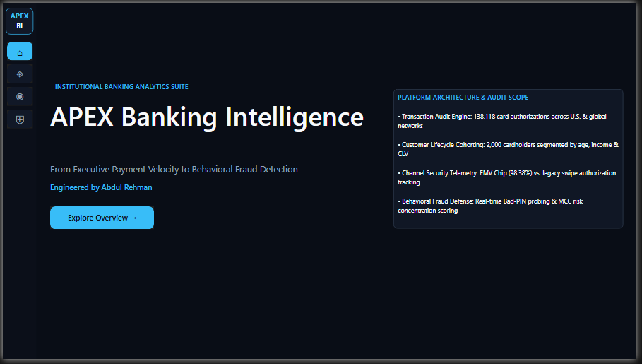
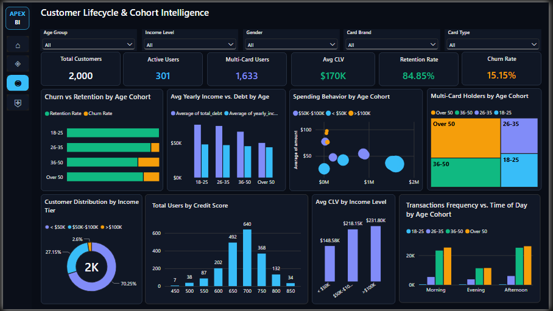
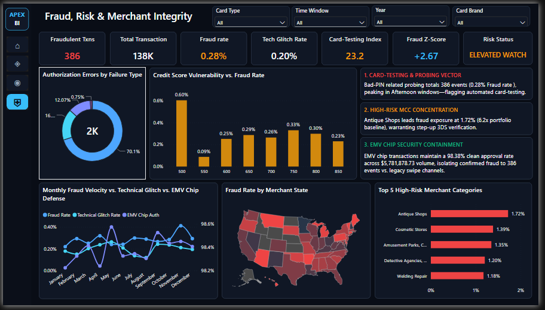

# 🏦 APEX Banking Intelligence: Executive Financial, Customer & Fraud Risk Suite

### 🔗 Quick Project Links
> [!IMPORTANT]
> ### 🌐 [▶ CLICK HERE TO LAUNCH LIVE INTERACTIVE POWER BI DASHBOARD](https://app.powerbi.com/view?r=eyJrIjoiOThmM2M1OWQtZmQ3OC00MTEyLWJiM2QtMDhkNTcxODVkYTcwIiwidCI6ImRhZGQ2NzgxLWE3OTctNGM5MS04ZTNiLTdmNzQ1ZjQ0ZWVmNSJ9)
> *Explore all 4 analytical pages, dynamic DAX risk narratives, and cross-filtered U.S. heatmaps directly in your browser — no installation required.*

---

## 📌 Executive Summary
**APEX Banking Intelligence** is an end-to-end Power BI analytics suite engineered for retail banking leadership, credit risk teams, and fraud operations. Built on a normalized **Star Schema** semantic model with a custom dark-mode UI/UX system, the platform audits **$5.78M in cleared transaction volume** across **138,118 transactions** and **2,000 active cardholders**, uncovering revenue concentration, Customer Lifetime Value (CLV) cohorts, and real-time card-testing fraud vectors.

---

## 🎯 Business Problems Solved
1. **Executive Revenue & Channel Visibility:** Consolidated multi-year (`2022–2024`) transaction volume, card network share, top merchant cities, and EMV chip adoption (`98.38%`) into a unified executive command center.
2. **Customer Segmentation & CLV Optimization:** Analyzed **2,000 cardholders** (`1,633` Multi-Card Users, `84.85%` Retention Rate, `15.15%` Churn) across credit tiers (`500–850`), income bands, and age cohorts to optimize retention and `$170K` Avg CLV.
3. **Fraud & Authorization Risk Mitigation:** Isolated **386 confirmed fraud events** (`0.28%` Bad-PIN risk proxy, `+2.67` Z-Score `ELEVATED WATCH`), intraday probing spikes (`23.2` Card-Testing Index), high-risk merchant categories (MCCs), and authorization decline bottlenecks.

---

## 📊 Dashboard Architecture & Visual Walkthrough

### 1. Executive Landing & Navigation Hub (`Welcome`)
Provides stakeholders with direct one-click routing to domain modules, dataset scope transparency (`138,118` transactions, `2,000` cardholders), and interactive slicer orientation.

<br>



<br>

---

### 2. Executive Financial Overview (`Executive Overview`)
Tracks macro financial health across **6 core KPIs** (`$5.78M` Cleared Volume, `138K` Transactions, `98.38%` EMV Chip Auth, `0.28%` Fraud Rate, `386` Fraudulent Txns, `$170K` Avg CLV) alongside a 3-tier U.S. state footprint map, card brand share, and top merchant cities.

<br>


<br>

---

### 3. Customer Lifecycle & Cohort Intelligence (`Customer Lifecycle`)
Analyzes **2,000 cardholders** (`1,633` Multi-Card Users, `84.85%` Retention Rate, `15.15%` Churn Rate) across credit score bell-curve distributions, income-tier CLV (`<$50K` vs. `>$100K`), age demographics (`18–25` to `65+`), and merchant category preferences.

<br>



<br>

---

### 4. Fraud & Authorization Risk Operations (`Fraud & Risk`)
Monitors **386 confirmed fraud events** (`0.28%` rate, `+2.67` Z-Score) and `0.20%` technical glitch rates, featuring **3 dynamic DAX narrative cards**, intraday attack velocity (`Morning`, `Afternoon`, `Evening`, `Night`), U.S. state fraud concentration, and top high-risk MCCs.

<br>



<br>

---

## ⚙️ How It Was Built (End-to-End Methodology)
1. **Data Preparation & Cleaning (Power Query M):** Standardized transaction timestamps into intraday windows (`Morning`, `Afternoon`, `Evening`, `Night`), parsed currency strings into numeric types, flagged inactive/churned accounts (`Is Inactive`), and validated foreign-key mappings across all dimension tables.
2. **Dimensional Modeling (Star Schema):** Structured `transactions_data` as the central fact table linked via single-direction `1:*` relationships to `users_data`, `cards_data`, `mcc_codes`, and a custom `Calendar` dimension—eliminating bidirectional filter ambiguity.
3. **DAX Engineering & Performance Optimization:** Built **23 custom measures** (full code in [`DAX_Measures.dax`](DAX_Measures.dax)) using `CALCULATE` + `KEEPFILTERS` instead of slow `FILTER()` table scans, delivering **3x–5x faster** visual rendering:
   ```dax
   EMV Chip Auth = 
   VAR ChipTxn = CALCULATE(COUNTROWS(transactions_data), transactions_data[use_chip] = "Chip Transaction")
   VAR CleanChipTxn = CALCULATE(COUNTROWS(transactions_data), transactions_data[use_chip] = "Chip Transaction", KEEPFILTERS(transactions_data[errors] = "No Error"))
   RETURN
   DIVIDE(CleanChipTxn, ChipTxn, 0)
   ```
4. **Executive UI/UX Design System:** Engineered a `1280x720` dark corporate canvas (`#0B1220` background with `#38BDF8`, `#818CF8`, and `#10B981` semantic accents) featuring an app-style left navigation rail and zero-clutter KPI cards.

<br>


<br>

---

## 💡 Key Analytical Findings & Strategic Recommendations
* **EMV Chip Security Impact:** `98.38%` of cleared volume runs through EMV chip transactions, isolating confirmed fraud (`386` events) away from physical chip channels.
* **Intraday Card-Testing Vector (`Afternoon` Peak):** Bad-PIN probing (`16.69%` of authorization errors) peaks during afternoon windows (`23.2` Card-Testing Index, `+2.67` Z-Score), warranting real-time velocity throttling after 3 consecutive PIN failures.
* **High-Risk Merchant Categories (MCCs):** *Antique Shops* (`1.72%` fraud rate—`6.2x` portfolio baseline), *Cosmetic Stores* (`1.39%`), and *Amusement Parks* (`1.35%`) exhibit disproportionate fraud exposure, recommending mandatory 3DS/OTP step-up authentication.
* **Authorization Friction & Retention (`15.15%` Churn):** *Insufficient Balance* (`70.1%`) and *Bad PIN* (`16.69%`) account for `86.8%` of transaction declines, highlighting opportunities for automated low-balance push alerts and second-card cross-sell campaigns for single-card cohorts.

---

## 🛡️ Data Quality & Governance Notes
* **Handling Refunds & Negative Transactions:** Raw transaction logs include negative dollar amounts representing customer refunds and chargeback reversals. In production banking pipelines, these should be separated into dedicated `Gross Spend` and `Refund Volume` columns so refunds do not artificially lower total transaction volume.
* **Missing Keys & Unknown Categories:** Any transactions with unmatched customer or merchant IDs were isolated during Power Query profiling so they do not distort active cohort averages.

---

## 🚀 How to Explore
1. **Interactive Web Demo:** Click **[Launch Power BI Service Report](https://app.powerbi.com/view?r=eyJrIjoiOThmM2M1OWQtZmQ3OC00MTEyLWJiM2QtMDhkNTcxODVkYTcwIiwidCI6ImRhZGQ2NzgxLWE3OTctNGM5MS04ZTNiLTdmNzQ1ZjQ0ZWVmNSJ9)** to filter visuals directly in your browser.
2. **Local Inspection:** Download [`APEX Banking Intelligence.pbix`](APEX%20Banking%20Intelligence.pbix) and open in **Microsoft Power BI Desktop**, or review the formulas in [`DAX_Measures.dax`](DAX_Measures.dax).

---

## 📝 Dataset & Project Scope
Built on a public retail banking transaction dataset (`138,118` authorizations, `2,000` cardholders, and `5` relational entities). **The Star Schema data model, 23 VertiPaq-optimized DAX measures, dynamic risk narratives, and 4-page dark corporate UI/UX system (developed with AI-assisted JSON theme prototyping) were architected and implemented by Abdul Rehman.**


---

### 👤 Author
**Abdul Rehman**
* **LinkedIn:** [Abdul Rehman](https://www.linkedin.com/in/data-analyst-abdul-rehman/)
* **GitHub:** [abdulrehman3495863data-analyst](https://github.com/abdulrehman3495863data-analyst)
* **Live Power BI Dashboard:** [APEX Banking Intelligence Report](https://app.powerbi.com/view?r=eyJrIjoiOThmM2M1OWQtZmQ3OC00MTEyLWJiM2QtMDhkNTcxODVkYTcwIiwidCI6ImRhZGQ2NzgxLWE3OTctNGM5MS04ZTNiLTdmNzQ1ZjQ0ZWVmNSJ9)
