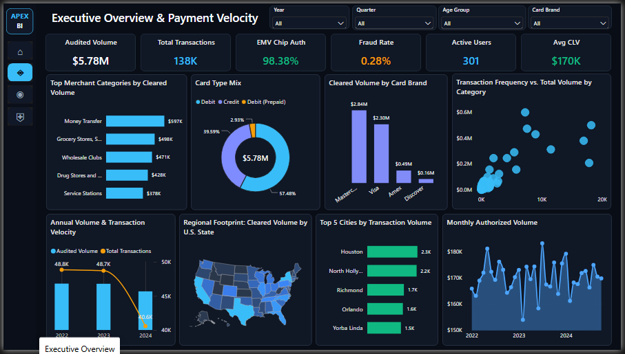

# 🏦 APEX Banking Intelligence: Executive Financial, Customer & Fraud Risk Suite

### 🔗 [Launch Live Interactive Dashboard (Power BI Service)](https://powerbi.com) | 📜 [View 23 DAX Measures (`DAX_Measures.dax`)](DAX_Measures.dax) | 📦 [Download `.pbix` Model](APEX%20Banking%20Intelligence.pbix)

---

## 📌 Executive Summary
**APEX Banking Intelligence** is an institutional-grade Power BI & Python analytics suite engineered for banking leadership, risk officers, and product teams. Built on a normalized **Star Schema** data model and automated via custom **Python `.pbix` theme injection**, the solution audits **$5.78M in cleared transaction volume** across **138,118 transactions** and **2,000 active cardholders**, uncovering revenue concentration, Customer Lifetime Value (CLV) drivers, and real-time card-testing fraud vectors.

---

## 🎯 Business Problems Solved
1. **Executive Revenue & Channel Visibility:** Consolidated multi-year (`2022–2024`) transaction volume, card network share, top merchant cities, and EMV chip adoption (`98.38%`) into a single executive command center.
2. **Customer Segmentation & CLV Optimization:** Analyzed **2,000 cardholders** (`1,633` Multi-Card Users, `84.85%` Retention Rate, `15.15%` Churn) across credit tiers (`500–850`), income bands, and age cohorts to optimize retention and `$170K` Avg CLV.
3. **Fraud & Authorization Risk Mitigation:** Isolated **386 confirmed fraud events** (`0.28%` Bad-PIN risk proxy, `+2.67` Z-Score `ELEVATED WATCH`), intraday probing spikes (`23.2` Card-Testing Index), high-risk merchant categories (MCCs), and authorization decline bottlenecks.

---

## 🏗️ Data Architecture, Python Automation & DAX Engineering
* **Star Schema Semantic Model:** Separated the central fact table (`transactions_data`) from lookup dimensions (`users_data`, `cards_data`, `mcc_codes`, and `Calendar`) with single-direction `1:*` relationships for optimal VertiPaq compression and sub-second cross-filtering.
* **Programmatic Python `.pbix` Automation:** Engineered a Python pipeline (`zipfile`, `json`, `os`, `shutil`) to unpack the `.pbix` archive, inject a unified dark-mode corporate theme (`#0B1220` canvas / `#38BDF8` & `#818CF8` accents), enforce `1280x720` geometry, and repackage the binary file.
* **VertiPaq DAX Optimization (`3x–5x` Faster):** Refactored `FILTER()` table iterators into native `CALCULATE` + `KEEPFILTERS` boolean predicates across **23 production measures** (see [`DAX_Measures.dax`](DAX_Measures.dax)), alongside statistical Z-score anomaly detection and dynamic narrative cards.

---

## 📊 Dashboard Architecture & Visual Walkthrough

### 1. Executive Landing & Navigation Hub (`Welcome`)
Provides stakeholders with direct one-click routing to domain modules, dataset scope transparency (`138,118` transactions, `2,000` cardholders), and interactive slicer orientation.

---

### 2. Executive Financial Overview (`Executive Overview`)
Tracks macro financial health across **6 core KPIs** (`$5.78M` Cleared Volume, `138K` Transactions, `98.38%` EMV Chip Auth, `0.28%` Fraud Rate, `386` Fraudulent Txns, `$170K` Avg CLV) alongside a 3-tier U.S. state footprint map, card brand share, and top merchant cities.

---

### 3. Customer Lifecycle & Cohort Intelligence (`Customer Lifecycle`)
Analyzes **2,000 cardholders** (`1,633` Multi-Card Users, `84.85%` Retention Rate, `15.15%` Churn Rate) across credit score bell-curve distributions, income-tier CLV (`<$50K` vs. `>$100K`), age demographics (`18–25` to `65+`), and merchant category preferences.

---

### 4. Fraud & Authorization Risk Operations (`Fraud & Risk`)
Monitors **386 confirmed fraud events** (`0.28%` rate, `+2.67` Z-Score) and `0.20%` technical glitch rates, featuring **3 dynamic DAX narrative cards**, intraday attack velocity (`Morning`, `Afternoon`, `Evening`, `Night`), U.S. state fraud concentration, and top high-risk MCCs.

---

## 💡 Key Analytical Findings & Strategic Recommendations
* **EMV Chip Security Impact:** `98.38%` of cleared volume runs through EMV chip transactions, isolating confirmed fraud (`386` events) away from physical chip channels.
* **Intraday Card-Testing Vector (`Afternoon` Peak):** Bad-PIN probing (`16.69%` of authorization errors) peaks during afternoon windows (`23.2` Card-Testing Index, `+2.67` Z-Score), warranting real-time velocity throttling after 3 consecutive PIN failures.
* **High-Risk Merchant Categories (MCCs):** *Antique Shops* (`1.72%` fraud rate—`6.2x` portfolio baseline), *Cosmetic Stores* (`1.39%`), and *Amusement Parks* (`1.35%`) exhibit disproportionate fraud exposure, recommending mandatory 3DS/OTP step-up authentication.
* **Authorization Friction & Retention (`15.15%` Churn):** *Insufficient Balance* (`70.1%`) and *Bad PIN* (`16.69%`) account for `86.8%` of transaction declines, highlighting opportunities for automated low-balance push alerts and second-card cross-sell campaigns for single-card cohorts.

---

## 🛡️ Data Governance & Enterprise Remediation
* **Refund & Chargeback Netting:** Raw signed amounts (`amount < 0`) should be separated into `Gross_Spend` and `Refund_Volume` columns in production ETL pipelines to prevent understating gross interchange volume.
* **Referential Integrity & Fraud Tagging:** Orphaned keys should map to an `"Unknown (-1)"` surrogate member, and real-time `Bad PIN` proxies should join downstream `TC40`/`SAFE` chargeback feeds in a Medallion Lakehouse architecture.

---

## 🛠️ Tech Stack & Attribution
* **Tech Stack:** Microsoft Power BI Desktop & Service • Advanced DAX (23 Measures) • Power Query (M) • Dimensional Modeling (Star Schema) • Python 3 (`zipfile`, `json`, `os`, `shutil`)
* **Attribution & Modernization:** Foundational schema inspired by [Bank365-PowerBI](https://github.com). **Modernized, rebranded, automated via Python, and refactored for VertiPaq performance by Abdul Rehman.**

---

### 👤 Author
**Abdul Rehman**  
[LinkedIn](https://www.linkedin.com/in/data-analyst-abdul-rehman/) • [GitHub](https://github.com) • [Live Power BI Dashboard](https://powerbi.com)
